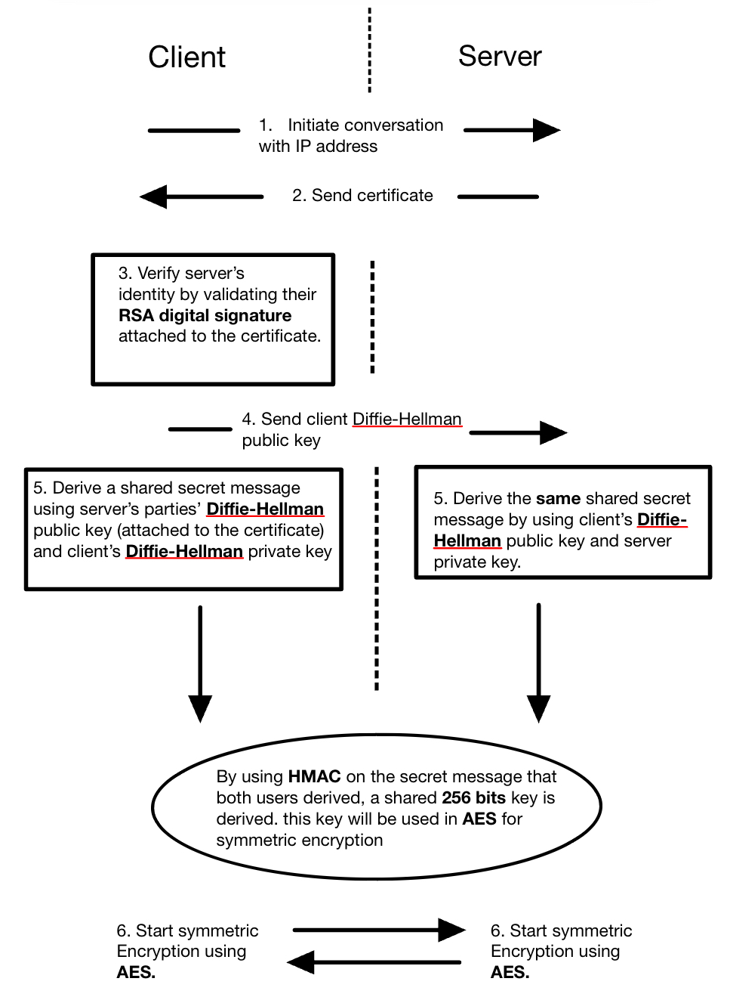

# Python-TLS_Handshake
This is an implementation of the TLS protocol that completed as a side project in Winter 2026 (February to May). My initial goal for this project was to understand encryption algorithms better, in preparation for a presentation on RSA. However, thanks to the momentum I gained while coding this, I decided to commit to implementing the full protocol. This project was initially only stored locally on my computer, but I decided to finally upload it to GitHub late in Fall 2026.

**AI Disclosure** Copilot was used to generate the code for `chat.py`, which contains functions allowing two computers to communicate on a local network. `chat.py` was not directly used in the final product (i.e. they are not imported anywhere), but its functions were modified by myself to integrate the encryption functions. All other files were written by myself, following the ideas of the papers in the references section.

# Design

***Figure 1** Summary of the design, drawn by myself on Notability*

This project directly implements the ideas of four foundational papers in cryptography: RSA, (ephemeral) Diffie-Hellman, AES (Rijndael), and HMAC [1-4]. Two computers are required to run the code: one designated as a server, and the other as the client. First, the client computer initiates the conversation by connecting to the server through the server's local IP address. Then, the server sends its certificate. This certificate is a String containing information about the server's identity, its public Diffie-Hellman key and a digitally signed version of all this data using its RSA private key. The client then validates the server's identity with corresponding RSA public key (using the `RSA` class). If the identity matches, it sends its own Diffie-Hellman public key, otherwise it stops the program and warns the user. Both client and server combine the Diffie-Hellman public keys with their own private keys (by modular exponentiation) and thus generate the common private pre-key. This pre-key is passed through a version of HMAC based on SHA-256 to generate the final symmetric key. This allows the final symmetric key to be more secure to the the pseudo-random nature of HMAC. This key is then passed as parameter to the `AES` class. Now that both client and server have a connection on the local network and an initialized AES object, they can proceed to encrypted communication.

# Dependencies and Running the Code

The program requires Python 3 and a random prime number generator (such as the `openssl prime` terminal command). To run the code, both client and server have to be on the same local network. The server first runs `main_server.py`, and the client runs `main_cli_2.py`, after inputting the server's local IP to the `PEER_IP` variable.

# References
1. Rivest RL, Shamir A, Adleman L. A method for obtaining digital signatures and public-key cryptosystems. Communications of the ACM [Internet]. 1978 Feb 1 [cited 2026 Oct 31];21(2):120–6. Available from: http://people.csail.mit.edu/rivest/Rsapaper.pdf
2. Diffie W, Hellman M. New directions in cryptography. IEEE Transactions on Information Theory [Internet]. 1976 Nov [cited 2026 Oct 31];22(6):644–54. Available from: http://www.cs.jhu.edu/~rubin/courses/sp03/papers/diffie.hellman.pdf
3. National Institute of Standards and Technology (US). Advanced encryption standard (AES). 2001;.
4. Bellare AM, Canetti R, Krawczyk H, Claims AI. Keying hash functions for message authentication | proceedings of the 16th annual international cryptology conference on advances in cryptology. Guide Proceedings [Internet]. [cited 2026 Oct 31];. Available from: https://dl.acm.org/doi/10.5555/646761.706031
